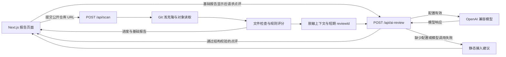

# Git 仓库接入体检

输入公开 Git 仓库的 HTTPS 地址，以默认分支的一个确切提交为基准，评估文档、依赖、启动方式、跨平台兼容性、硬编码路径及凭据暴露风险。报告适合在接手开源项目、引入依赖或评审仓库接入时使用。

## 功能

- 支持 GitHub、GitLab、Bitbucket、Codeberg 和 Gitee 的公开仓库，页面实时显示拉取、结构分析、风险扫描和报告生成进度。
- 规则评分满分 100，按工程完整度 40 分、跨平台与路径 30 分、安全 30 分计算。报告列出逐项得分和原因，可按严重程度或类别筛选风险、查看位置及修复建议，并复制为 Markdown。
- 报告标注仓库、分支、提交 SHA 和扫描时间。风险片段中的匹配凭据会脱敏。
- 基础报告完成后异步加载接入点评，展示项目定位、架构、上手难度、启动指南和三条优先整改建议。配置模型后，AI 评分与规则评分并列展示。模型不可用时显示静态建议。

## 功能截图

> **截图占位 · 报告总览**　待补图。建议截取仓库元信息、规则评分、维度进度条和关键指标。

> **截图占位 · 风险与接入建议**　待补图。建议截取脱敏风险片段、完整度清单及 AI 或静态建议面板。

## 本地运行

需要 Node.js **22.18 或更新版本**、npm 和 Git。运行环境需要能访问待扫描的公开 HTTPS 仓库，并允许写入系统临时目录。

```bash
npm ci
npm run dev
```

打开 [本地页面](http://localhost:3000)，可先查看标注为模拟数据的示例报告，再扫描 `https://github.com/octocat/Hello-World` 等公开仓库。

### 环境变量

基础扫描可以直接运行。启用 AI 点评时，将 [`.env.example`](.env.example) 复制为项目根目录下的 `.env.local`，填入对应提供方的服务端配置并重启应用。

| 变量 | 用途 | 默认值 |
| --- | --- | --- |
| `OPENAI_API_KEY` | OpenAI 兼容服务的密钥，由服务端读取。真实值只放在本地环境或部署平台的密钥配置中 | 空，使用静态建议 |
| `OPENAI_BASE_URL` | 兼容 API 的基地址。服务端补齐 `/chat/completions` | `https://api.openai.com/v1` |
| `OPENAI_MODEL` | 提供方接受的模型 ID | `gpt-4o-mini` |

运行 `npm run test:scan` 可离线验证本地 Git 测试仓库、扫描规则、脱敏和模拟模型接口。`npm run typecheck` 和 `npm run lint` 分别执行类型及风格检查。生产模式先运行 `npm run build`，再运行 `npm run start`。

## 技术架构

前端使用 Next.js App Router、React、TypeScript、Tailwind CSS 和 Lucide React。Node.js 扫描接口以参数数组调用 Git，浅克隆到独立临时目录，直接读取提交对象，分析结束后清理目录。报告阶段通过 NDJSON 推送到页面，普通 API 调用也可接收 JSON 报告。



扫描预算、评分细则和点评上下文见 [架构说明](ARCHITECTURE.md)。

## 仓库更新跟踪与增量检查设计（Update Tracking Design）

**对应题目要求 5。** 当前版本按请求扫描默认分支，并在报告中保留确切的提交、分支与时间。以下 Webhook、定时轮询、持久化快照、增量复用与过期提醒为后续设计。现有 `reviewId` 只用于短期 AI 点评，报告缓存需要独立存储。

### 1. 如何发现原仓库更新

| 方式 | 适用场景 | 实现与取舍 |
| --- | --- | --- |
| GitHub Webhook | 已接入、具备安装 GitHub App 或配置 Webhook 权限的仓库 | 订阅 `push`，按仓库和目标分支匹配 `ref`。对 HTTPS 请求的原始请求体校验签名，按 `X-GitHub-Delivery` 去重，快速返回成功并入队。延迟低，须处理漏送、乱序、分支删除和强推。 |
| 定时轮询 + ETag | 无法配置 Webhook、仍希望追踪的公开 GitHub 仓库 | 调用 `GET /repos/{owner}/{repo}/commits?sha={branch}&per_page=1`。首个 `200` 保存响应的 `ETag` 及首条提交 SHA，后续以相同端点、参数和认证发送 `If-None-Match`。`304` 复用已探测的 SHA，`200` 更新校验器并比较新 SHA。 |
| Git 引用探测 | 通用公开 Git 主机、未配置 GitHub 认证或 REST 通道暂不可用 | `git ls-remote <url> HEAD` 只读远端引用和提交 ID，无需下载提交对象。`git ls-remote --symref <url> HEAD` 可同时读取默认分支引用。追踪固定分支时查询 `refs/heads/<branch>` 并精确匹配返回行。 |

GitHub 的条件请求需正确携带 `Authorization`，且实际返回 `304 Not Modified`，才不计入**主要 REST 限流**。`200` 仍会消耗配额，轮询仍需遵守次要限流。`304` 表示 API 响应相对上次无变化。若该 SHA 已发现但尚未成功扫描，仍应恢复对应的扫描任务。 [GitHub Commits API](https://docs.github.com/en/rest/commits/commits#list-commits) · [GitHub REST 条件请求](https://docs.github.com/en/rest/using-the-rest-api/best-practices-for-using-the-rest-api#use-conditional-requests)

已接入的仓库优先用 Webhook，低频轮询用来补偿漏送，并检测默认分支切换。Webhook 与轮询产生统一的更新任务，按规范化仓库 URL、完整分支引用和目标 SHA 去重。任务处理前复核分支头，避免把乱序的推送当成最新版本。Git 探测延用现有 URL 白名单、参数数组和超时机制。 [GitHub Webhook 最佳实践](https://docs.github.com/en/webhooks/using-webhooks/best-practices-for-using-webhooks) · [git ls-remote](https://git-scm.com/docs/git-ls-remote)

### 2. 如何避免全量重算

1. **定位基线。** 按规范化仓库 URL 与目标分支维护最近成功的 `lastCommitSha`，另存最后探测到的 `latestSha`。报告快照以仓库、分支、提交、规则版本及扫描配置为键。若 SHA、规则与配置一致且缓存存在，直接返回报告，只更新探测时间，保留原始扫描时间。
2. **取变更清单。** SHA 不同则固定本次扫描的目标提交，在两个提交对象均可用时执行以下命令。`--name-only` 用于获取变更路径，生产实现用 `--name-status -z -M` 区分类型、保留重命名两端，并以 NUL 分隔文件名。比较的是两个提交的文件树。 [git diff](https://git-scm.com/docs/git-diff)

   ```bash
   git diff --name-only <oldSha> <newSha> --
   git diff --name-status -z -M <oldSha> <newSha> --
   ```

3. **更新文件级结果。** 仅对新增、内容修改或扫描资格变化后需要读取的文件执行规则和正则检查。未变化文件复用同规则版本下的历史结果。删除文件时清除旧发现。重命名时删除旧路径记录，按新路径重新应用文件名、扩展名和目录规则。内容相同且内容规则适用条件相同的 blob 可复用内容级结果。文件类型、目录过滤、大小限制或总预算改变导致文件进入、退出本次覆盖范围时，按新提交重新判定其检查状态。
4. **重新汇总与发布。** 用当前提交的文件清单和文件级结果重算完整度、风险分布、覆盖范围及总分。缓存保留每个文件的状态、脱敏后的发现和完整计数，以支持重新汇总。在新快照及文件级结果成功落盘后原子更新 `lastCommitSha`。扫描失败时保留原基线。同一分支的任务串行提交，较旧任务完成时核对当前目标，避免覆盖新报告。

现有 `git clone --depth 1 --no-checkout` 只保证能读取新提交，旧提交可能缺失。实现增量时，可复用保留上一已扫描对象的服务端 Git 缓存，或在时间和体积预算内尝试补取旧提交、加深浅克隆。首次扫描、旧对象无法取得、规则或预算版本变化、强推后无法建立可靠基线时，对新提交执行一次完整扫描。探测后若分支再次移动，应按实际读到的 SHA 生成报告和排队复扫，避免把 A 的内容标成 B。 [git fetch](https://git-scm.com/docs/git-fetch)

### 3. 报告如何标注所基于的 Commit

- **已实现。** `ScanReport.repository` 保存 `commitHash`（完整 SHA）、`branch` 与 `scannedAt`（ISO 8601 UTC）。顶部元信息条展示分支、SHA 的前 12 位与扫描时间（UTC+8），悬停可查完整 SHA，复制按钮复制完整 SHA，Markdown 导出也保留完整值。
- **拟新增。** 在报告元数据之外记录 `latestSha`、`lastCheckedAt` 和新鲜度状态。远端 SHA 已确认不同、当前仍在查看旧快照时，顶部提示「当前报告基于历史版本 `abc1234`，远端已有更新」，可同时展示探测到的目标短 SHA、探测时间和刷新入口。远端无法确认时显示「数据可能已过期」，保留原始扫描时间。
- **版本切换。** 新扫描完成后，以同一提交的元数据、风险和评分整体替换当前快照。固定分支和默认分支按各自的引用记录探测状态，默认分支切换后重新选择该分支的基线。

### 4. 失败或限流时的兜底策略

| 情况 | 后端策略 | 页面表现 |
| --- | --- | --- |
| GitHub REST 限流 | 对确认属于限流的 `403` 或 `429`，读取 `Retry-After`、`X-RateLimit-Remaining` 和 `X-RateLimit-Reset`。优先等待 `Retry-After` 指定的时长。剩余配额为零时至少等到重置时刻，两项同时适用时取较晚时间。次要限流无指示时至少等待一分钟，再以带抖动的指数退避做有限次重试。 | 继续展示最近成功报告，并显示更新检查延迟。 |
| REST 暂不可用，Git 通道可达 | 对受支持的公开 URL，切换到 `git ls-remote` 探测。确认有新提交或确实需要建立基线时，使用 `git clone --depth 1` 获取 Git 对象。Git 通道独立于 REST 配额，仍需遵守主机限制、并发和超时预算。 | 探测成功后更新新鲜度。有更新时保留旧报告并提示可刷新或正在复扫。 |
| 仓库不可达、超时或新扫描失败 | 保留最近一次成功的缓存快照，记录失败原因和尝试时间，延迟复查。权限失败与仓库不存在单独处理。若已确认访问权限撤销，则按访问策略隐藏缓存。 | 有可用快照时提示「数据可能已过期」，保留原提交、分支和扫描时间。无可用快照则显示具体错误和重试入口。 |

退避任务按仓库和分支合并，避免故障时从多条路径反复重试。REST 限流策略依据 GitHub 的响应头制定。 [GitHub REST 限流说明](https://docs.github.com/en/rest/using-the-rest-api/rate-limits-for-the-rest-api#exceeding-the-rate-limit)

**增量验收。** 使用两个以上提交的测试仓库，对比同一目标 SHA 的增量报告与全量报告。覆盖 SHA 未变、文件增删改和重命名、规则版本变更、旧对象缺失、重复推送、`304`、限流及超时。核对风险、评分、覆盖状态和提交标注，并记录实际重新检查的文件数量。

## AI 使用记录

[AI_USAGE.md](AI_USAGE.md) 提供工具、提示词、人工验证和纠错记录的填写模板。
